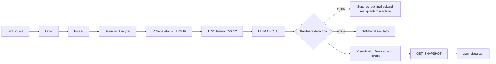

<div align="center">


# Ravendrel — Quantum Programming Language

[](https://github.com/LukaKrajina/Ravendrel/stargazers)
[](https://github.com/LukaKrajina/Ravendrel/network/members)


[中文](./README.md)

</div>

Ravendrel (`.rvdl`) is an experimental programming language targeting **quantum computing + neural interfaces + quantum language models + quantum robotics**. This repository ships a full **VS Code language extension**, an **LLVM ORC JIT runtime**, a **CLI toolchain**, a **web inference UI**, a **Go installer**, a **real-time quantum visualizer**, the **VedaROS quantum robotics operating system**, and the **QbNS quantum brain network**.

---

## ✨ Features

| Feature | Description |
| --- | --- |
| Quantum programming | Qubit allocation, quantum objects, measurement, Bell states, quantum registers (`Qubit` / `QObject` / `measure` / `DiracState` / `BellState` / `QuantumRegister`) |
| Quantum HAL | Auto-detect real quantum machines (FPGA superconducting / trapped-ion / neutral-atom / photonic backends), otherwise fall back to the local QVM simulator; offline physical backends are bridged by an ideal state vector (`IdealStateCore`) + hardware noise channels (amplitude damping / phase flip / depolarizing) for correct Born-rule collapse |
| Quantum Language Model (QLM) | Variational quantum circuit training, model export (`.rvdlm`), text ↔ quantum-state encoding/decoding |
| QRC Quantum Reservoir Computing | `qrc_new` / `qrc_train` / `qrc_probe` / `qrc_predict` / `qrc_release` intrinsics + the `QReservoir` type: train a linear readout on synthetic sinusoid series, validating barren-plateau-free reservoir computation |
| TQNF Topological Quantum Neural Field | QObject-level gates `qgate_h`/`qgate_x`/`qgate_rz`/`qgate_cnot` (borrow, non-consuming), cross-object controlled gate `qgate_cnot_pair` (POVM weak measurement), non-destructive expectation `qexpect_z`, partial-collapse measurement `qmeasure`, qubit-count query `qobj_num_qubits`, SWAP-test attention `qattention`, state metrics `qstate_entropy`/`qstate_fidelity`, measurement entropy `shannon4`/`shannon8`, trainability diagnostic `dla_dim` (dynamical Lie algebra dimension) |
| POVM measurement | Cross-object controlled gates (system qubit controlling an ancilla) implement weak measurement without fully collapsing the system state; multi-qubit variational ansätze align state dimension via `qobj_num_qubits` |
| Retrocausal channel capacity | `retrocausal_imax` / `_idoe` / `_q_capacity` / `_c_capacity` / `_q_one_shot` / `_gain` / `_deformed(kind, p[, x])`: P-CTC backward-time communication capacity from the channel's Choi matrix (max-information / Doeblin / asymptotic & one-shot quantum·classical capacities / q-deformed capacity / backward gain); `kind` covers depolarizing / dephasing / bit-flip / amplitude-damping / unitary Hadamard / bit-phase-flip |
| Tachyon KK double-space CTC | `retrocausal_ctc_q_capacity` / `_c_capacity` / `_gain(n, theta, mu2, lambda)` / `retrocausal_ctc_dephasing(theta)`: noisy CTC capacity generated physically by a tachyon field propagating in the KK extra dimensions (DD double space) — Wilson-line dephasing / dimensional diffusion depolarizing / tachyon-vacuum damping; the `coord` dimension of `@layer` is the extra-dimension count n |
| Non-Euclidean surface-body geometry | `geodesic_distance(a, b)` (Fubini-Study geodesic distance via SWAP-test overlap) / `inversion(R)` (T-duality `R→1/R`) / `hyperbolic_metric(x)` / `hyperbolic_distance(x, y)` (Poincaré-ball metric and hyperbolic distance) |
| Brain-Computer Interface (BCI) | `mind_read` / `mind_train` / `mind_feedback` — encode neural signals into quantum states via the QbNS Transducer |
| QbNS Quantum Brain Network | `Transducer` (neural→quantum encoding), `Rmx` (distributed hybrid network), `qbw` (brain quantum waves / quantum streams / distribution links) |
| VedaROS Quantum Robotics OS | A quantum distributed OS: QDDP decentralized protocol, rclcpp-like client library, rvdl custom language, transform tree, behavior-tree navigation, entangled-consciousness planning, hardware abstraction |
| Real-time quantum visualizer | `qvm_visualizer`: six live windows — circuit grid, state vector, Bloch sphere, quantum objects, measurement history, metrics |
| JIT execution | Just-in-time compilation via LLVM ORC JIT |
| AOT compilation | `rvdl compile` compiles scripts to native binaries (x32 / x64 / arm64 / android) |
| Android APK building | `rvdl build apk <file.rvdl>` one-click cross-compiles a `.rvdl` project into an Android APK (AOT compilation + lightweight runtime + Gradle packaging), install-and-run on ARM64 devices |
| `.rvdli` module system | `mod` / `use` / `import` / `export` / `requires` module declarations & imports/exports, packaged as `.rvdli` modules (RVDLI format) loaded and invoked at runtime |
| Type system | `form` / `trait` / `impl` / `template` / `rank` declarative types, generics, and trait implementations |
| Multiple declarations per line | Declare several same-typed variables in one line (`int32 a = 1, b = 2, c = 3;`); later declarators may reference earlier ones |
| Quantum gate intrinsics | Built-in `x` `y` `z` `h` `s` `t` `rz` `rx` `ry` `cnot` `toffoli` `swap` `qft` `iqft` `braid` gates, controlled gates `cx` `ch` `crz` `cswap` `c_toffoli` `cqft` `cbraid`, and `measure_x` / `measure_y` measurements |
| Quantum language migration | `rvdl migrate` transcompiles OpenQASM 2.0/3.0, Q#, Quil, and Silq source into `.rvdl` (source-to-source: multiple frontends + a unified CircuitIR + a single emitter, with automatic qelib1 gate decomposition) |
| Real concurrency | `spawn` blocks compile to standalone thread functions launched via the `rvdl_spawn` intrinsic with `std::thread` (detached), supporting closure capture of outer variables, paired with Q-Digest static race detection |
| Multi-dimensional tagged functions | `@layer(time, thread, coord[, cost, deadline][, dual][, shuttle…][, track…])` annotation-style entry points mapping execution to a "time × thread × runtime-coordinate" topology; five edge kinds (stack / parallel / projection / inversion / crossing) plus call-propagation latency are auto-derived at compile time (`E-TOP005` / `E-TOP006` / `E-TOP008` / `E-TOP009` diagnostics), then scheduled at runtime by `rvdl_runtime_run_topology` (time layering, per-layer parallelism by coordinate L1 code distance); two optional inert-by-default mechanisms — **shuttle** (threshold-free correlation kernel `w = exp(−d_L1/λ)`, five strategies incl. `O(1)`-depth Grover diffusion and the c001 butterfly-point, runtime auto selection) and **tracking** (three-level fidelity ladder with classical shadow slots) |
| Reversible Weaving gate synthesis | `@[gate]`/`@[undo]`/`@[steer]`/`@[unitary]`/`@[measure]` tags: automatic synthesis of the reversible dual U† (gate-order reversal + per-gate dagger) and coherent control Λ(U)|
| Quantum physical traits | `@[coherence]`/`@[noise]`/`@[basis]`/`@[decoherence_free]`/`@[error_correction]` tags: noise models & coherence-time constraints, auto-injecting noise after gates into the QVM and multiple hardware backends |
| Classic compile attributes | `@[inline]`/`@[noinline]`/`@[pure]`/`@[cold]`/`@[hot]`/`@[noreturn]`/`@[export]`, mapped to LLVM function attributes |
| Systems-level kernel programming | Register-read intrinsics (`read_cr3`/`rdmsr`/`wrmsr`/`cpuid`/`rdtsc`/`xgetbv` etc. — read CR3 / MSR / CPUID leaves back into `uint64` variables), raw assembly blocks `asm { }` + `@[naked]` (multi-instruction sequences: interrupt stubs saving all GPRs + `iretq`, stack switching, far-return changing CS), function pointers `fn<ret(params)>` indirect calls, `@[packed]` exact byte layout (GPT/FAT/ATA disk structures), `volatile_load/store` (MMIO polling), fixed-size arrays `arr<T,N>` literals & indexing, bitfields, full unsigned `uint64` arithmetic, and complex types |
| VS Code extension | vsx bundle: esbuild bundles + runtime artifacts shipped in `bin/` (`bin/win32-x64/`, `bin/linux-x64/`) — **one vsix carries both the Windows and Linux runtimes**, auto-selected via `process.platform`, so rvdl **runs/compiles/builds out of the box** (no separate runtime install); syntax highlighting + semantic completion + run/compile/build commands + **bilingual (zh/en) hover docs** (detailed keyword/type/builtin docs, auto-selected by system language) + right-click migration (`.qasm`/`.qs`/`.quil`/`.slq` → `.rvdl`) |
| VS Code sidebar | A Flutter-DevTools-style Activity Bar sidebar: **compile target** (x32/x64/arm64/android one-click switch, forwarded to the compiler; the Android target is `aarch64-linux-android` and requires the NDK cross toolchain), **actions** (run / compile / build-IR / **one-click Android APK build** (debug; release via the command palette) / migrate shortcuts), **performance monitoring** (compile/execute latency history chart, persisted across sessions in `globalState` + a clear button), **quantum objects & qubits** (live daemon snapshots: multi-qubit reduced-density-matrix Bloch spheres with 3D mouse rotation + state-vector probability histograms + measurement history) |
| HTTP inference server | `rvdl serve` exposes OpenAI-compatible `chat/completions`, `embeddings`, `models` endpoints |
| Web chat UI | Streaming inference chat UI built with Vite + Tailwind + Dexie |
| Toolchain manager | `ravendrelup` installer and version proxy written in Go |
| SE editor | A lightweight rvdl desktop editor (Electron + CodeMirror), reusing the language server pipeline with file open/save/run |
| rvdlRSP simulation platform | A quantum robotics simulation platform: physics kernel (QM/QVM), Vulkan PBR rendering, blueprint editing, QCDRC teleoperation, quantum RL, consciousness control |
| rvdlRSP Qt GUI | A Qt 6 + QVulkanWindow desktop simulation UI: real 3D viewport, World Outliner / Details panels, teleoperation / RL / consciousness control |
| Prosthetic limb / Bionic eye | Brain-controlled prosthetic limb (`ProstheticLimb`, EMG-driven) and bionic eye (`BionicEye`, EEG-driven) assisted by quantum RL (reusing `QuantumRLAgent` + `ConsciousnessController`), with physical robot driving and a bionic-eye camera |
| Domestic chip adaptation | LoongArch (LA64) arch detection with `idle 0`/`dbar 0` primitives and LSX/LASX vector detection; Moore Threads MUSA GPU backend detection (CUDA-like, mcc compiler + musa runtime) |
| QCOS bootable kernel | Write a bare-metal kernel in rvdl: a freestanding kernel core library `qcos_core` (no LLVM/Kokkos/libstdc++) plus boot sources in `runtime/qcos/` (Multiboot2 assembly / linker script / GRUB), built into a bootable ELF / ISO via `build-qcos-*.ps1` and run under QEMU; part of the official project [QuarkOS](https://github.com/LukaKrajina/QuarkOS) |

---

## 📁 Repository Layout

```
ravendrel-vscode/
├── client/                    VSCode extension client (LanguageClient)
├── server/                    Language server: lexer / parser / semantic / IR / mmi / CLI / HTTP API router
│   └── rvdl.cmd                 `rvdl` CLI entry point (Windows)
├── runtime/                   C++20 runtime: LLVM ORC JIT + Quantum Hardware Abstraction Layer (QHAL)
│   ├── src/                   Entry points & C ABI core (main.cpp / runtime_api.cpp / QObject.hpp / QDataEncoder.hpp) & kernel core (qcos_core.cpp / qcos_smoke.cpp)
│   ├── qcos/                  Bootable QCOS kernel boot sources (boot_x86_32.S / boot_x86_64.S / kernel_main.cpp / rvdl_shim.cpp / qcos_syscall.hpp / linker_x86_64.ld / grub config)
│   ├── android/               Android lightweight runtime (runtime_android.cpp + JNI bridge, CMakeLists.txt cross-compilation, apk/ Gradle project)
│   └── include/
│       ├── qcos/              Kernel core (freestanding): DragonPmm buddy-system PMM (buddy/free-list/TLSF/per-CPU cache) + BitmapPmm (v1 bitmap), Vmm, Spinlock/TicketSpinlock, Sched, Serial, Qms quantum numerics
│       ├── qhal/              Quantum HAL (QM / QVM / JIT / SandboxJIT / MMI / VisualizationService / IdealStateCore ideal-state + noise bridge / physical backends: superconducting / trapped-ion / neutral-atom / photonic / Karma QVPU / KarmaBus QVPL)
│       ├── qbNs/              Quantum Brain Network QbNS (Transducer / Rmx / qbw brain waves / qbNSBridge)
│       ├── vedaRos/           Quantum Robotics OS VedaROS (core / bridge / algorithm / hardware / quantum)
│       ├── gui/               Real-time quantum visualizer (protocol / components / windows / src)
│       ├── qlm/               Quantum Language Model QLM
│       ├── qml/               Quantum ML primitives (Layer / RVDLModelFormat / Inference)
│       ├── numqk/             Numerical tensor library Numqk (Tensor / Autograd / SoftLogic)
│       ├── spacetime/         Spacetime differential-geometry solvers (Foliation / Integrators / KaluzaKlein / NeuralField / SpectralEEG / TachyonField, etc.)
│       ├── verify/            Static verifier (Verifier / SmtLibEmitter / IntervalAbstract)
│       ├── stub/              Stub implementations (nabStub.hpp)
│       └── utils/             Utilities (FastPhaseRetrieval / Ga)
├── SE/                   Lightweight rvdl desktop editor (Electron + CodeMirror, reusing server pipeline)
│   ├── src/                   Electron main process + pipeline reuse + daemon connection
│   └── renderer/              CodeMirror editor + output Shell + status bar
├── rvdlRSP/                  Quantum robotics simulation platform (C++20, as a new runtime target)
│   ├── include/               core / qpc / qpu / circuit / blueprint / pcg / render / editor / control / bridge / qcdrc
│   ├── src/                   Entry points, Vulkan context, JIT host, stb_image impl, RL demo
│   ├── gui/                   Qt 6 simulation UI (qt windows + simulation_host kernel)
│   ├── shaders/               PBR shaders (GLSL)
│   └── tests/                 Unit tests (87 cases / 24 suites)
├── chatWebUI/              Web inference chat UI (Vite + Tailwind + Dexie)
├── installer/                 Go toolchain installer / version proxy (ravendrelup)
├── scripts/                   Build / signing scripts (Windows rvdl_rt build, Kokkos install, QCOS kernel/ISO/GRUB image, sign.ps1, deploy-wdac, Linux build & install)
├── examples/                  Example `.rvdl` programs
├── syntaxes/                  TextMate syntax highlighting
├── vendor/                    Third-party libraries (GLFW, Nuklear, etc.)
└── vcpkg/                     vcpkg dependency management
```

---

## ⚠️ Before You Build

> **Important**: The `.vscode/*.json`, `runtime/.clangd`, and `runtime/CMakeLists.txt` files in this repository contain **absolute paths** from the author's machine (Kokkos, CUDA, LLVM, GLFW, compiler locations, etc.). **Developers must update these files to match their own installation paths before building.** Do not use the hard-coded paths as-is.

Locations to change:

| File | Items to change |
| --- | --- |
| `runtime/CMakeLists.txt` | `Kokkos_DIR` (line 58, `C:/Libraries/kokkos/lib/cmake/Kokkos`), GLFW library dir `lib-vc2026` (line 48) |
| `rvdlRSP/CMakeLists.txt` | `Qt6_DIR` (line 127, `C:/Qt/6.11.2/msvc2022_64/lib/cmake/Qt6`, only needed to build `rvdlRSP_gui`) |
| `runtime/.clangd` | Kokkos / CUDA `-I` include paths (lines 7-8) |
| `.vscode/c_cpp_properties.json` | `compilerPath`, Kokkos/CUDA/LLVM `includePath` |
| `.vscode/settings.json` | `cmake.sourceDirectory` (workspace absolute path) |

See [🛠️ Dependencies & Build](#-dependencies--build) for how to download and compile dependencies.

---

## 🚀 Quick Start

### 1. VS Code Extension

```bash
npm install
npm run compile        # Compile client & server (tsc -b)
```

Press `F5` in VS Code to launch the extension in debug mode, or package it with `vsce package`. Opening any `.rvdl` file provides syntax highlighting, autocompletion, and semantic diagnostics.

- **Run script**: `Ctrl+Alt+N` (macOS: `Cmd+Alt+N`) or click the ▶ button in the top-right of the editor.

#### Packaging releases (vsix with the runtime bundled in `bin/`)

```bash
npm run package:linux   # Linux vsix (native runtime + *.so into bin/)
npm run package:win     # Windows vsix (cross-compiled runtime.exe + *.dll into bin/)
npm run package:all     # both platforms
```

Output goes to `dist/ravendrel-lang-<version>-linux-x64.vsix` and `dist/ravendrel-lang-<version>-win32-x64.vsix`.

- **Linux**: `scripts/build-linux.sh` builds the runtime (needs LLVM / Kokkos / Vulkan / GLFW); `scripts/prepare-vsix-runtime.sh` copies it into `bin/`.
- **Windows (cross-compile)**: `scripts/build-windows-cross.sh` cross-compiles the runtime on Linux using **MinGW-w64** (`x86_64-w64-mingw32-g++`), with `MINGW_DEPS_ROOT` pointing to MinGW builds of LLVM / Kokkos / Vulkan / zlib / zstd (layout described in `scripts/mingw-w64-toolchain.cmake`).
- The whole flow is orchestrated by `scripts/package-vsix.sh` (compile client/server → build runtime → copy `bin/` → `vsce package`).

### 2. C++ Runtime

The runtime depends on **LLVM**, **Kokkos**, and **Vulkan + GLFW + Nuklear**. See [🛠️ Dependencies & Build](#-dependencies--build) for the full dependency list and build instructions.

> ⚠️ Follow [Before You Build](#-before-you-build) to update hard-coded paths, or override them via command-line `-D` flags.

```bash
cd runtime
cmake -B build -S . -G "Ninja" \
  -DCMAKE_CXX_COMPILER="<your clang-cl / g++ / clang++ path>" \
  -DCMAKE_TOOLCHAIN_FILE="<your vcpkg path>/scripts/buildsystems/vcpkg.cmake" \
  -DLLVM_DIR="<your LLVM cmake directory>" \
  -DKokkos_DIR="<your Kokkos install>/lib/cmake/Kokkos" \
  -DCUDAToolkit_ROOT="<your CUDA install directory>"
cmake --build build --config Release --parallel
```

The build produces the following targets:

| Target | Type | Description |
| --- | --- | --- |
| `rvdl_rt` | Shared library | Quantum core (LLVM ORC JIT + QHAL + Kokkos), exporting a C ABI (`RuntimeApi.h`) |
| `qcos_core` | Static library | Freestanding kernel core (no LLVM / Kokkos / libstdc++, compiler builtins only) |
| `qcos_smoke` | Executable | Host smoke test (validates Pmm / Sched / Spinlock / LibcSubset logic) |
| `qchain_selftest` | Executable | Quantum blockchain core self-test (SHA3/ML-KEM/causality/UTXO) |
| `mir_module_test` | Executable | MirModuleBuilder lowering test (MIR JSON → LLVM Module) |
| `runtime` | Executable | Shell: socket daemon (`--daemon` listens on `localhost:50052`) + stdin interaction, calling `rvdl_rt` via the C ABI |
| `qvm_visualizer` | Executable | Real-time quantum visualizer (Vulkan + GLFW + Nuklear) |
| `transmitter` | Executable | QLM transmitter |

**Physics/Math Validation Benchmarks** (`-DRVDL_BUILD_BENCHMARKS=ON`, see [runtime/BENCHMARKS.md](runtime/BENCHMARKS.md)):

| Target | Type | Description |
| --- | --- | --- |
| `spacetime_benchmark` | Executable | Core tachyon field validation: linear growth/kink/energy/4th-order convergence |
| `spacetime_extended_benchmark` | Executable | Extended modules: spectral FFT/S² harmonics/high-genus/KK/O(D,D) |
| `neural_eeg_benchmark` | Executable | Cortical neural field symmetry breaking + EEG alpha spectral analysis |
| `nucleation_visualization` | Executable | Domain wall nucleation visualization (outputs PGM sequence) |
| `run_benchmarks` | Custom | One-shot run of all benchmarks (exit code 0 = all pass) |

**GUI/Framework Examples** (`-DRVDL_BUILD_EXAMPLES=ON`, see [runtime/EXAMPLES.md](runtime/EXAMPLES.md)):

| Target | Type | Description |
| --- | --- | --- |
| `fox_showcase` | Executable | Fox GUI framework showcase (macOS 27 Golden Gate styling) |

**rvdlRSP Simulation Platform** (see [RSP/EXAMPLES.md](RSP/EXAMPLES.md)):

| Target | Type | Description |
| --- | --- | --- |
| `rvdlRSP` | Executable | Quantum robotics simulation platform main program (physics kernel + Vulkan PBR + blueprints + teleoperation) |
| `rvdlRSP_rl_physics_demo` | Executable | Quantum RL end-to-end training example (`-DRVDLRSP_BUILD_EXAMPLES=ON`) |
| `rvdlRSP_benchmark` | Executable | RSP performance benchmark |
| `rvdlRSP_tests` | Executable | rvdlRSP unit tests (87 cases / 24 suites) |
| `rvdlRSP_sim` | Static library | Simulation kernel (physics / teleoperation / RL / QVM / consciousness, requires Qt 6) |
| `rvdlRSP_gui` | Executable | Qt 6 desktop simulation UI (requires Qt 6, optional) |

- **Foreground mode (stdin/stdout)**: `./runtime`
- **Daemon mode**: `./runtime --daemon` (used by CLI, API service, and visualizer)

### 3. Command-Line Tool

`server/rvdl.cmd` maps `rvdl` to the compiled `server/out/cli.js`:

```bash
rvdl run <script.rvdl>                                  # Run a script
rvdl ir <script.rvdl>                                   # Emit LLVM IR to stdout (no daemon connection)
rvdl compile <x32|x64|arm64|android> <-e|-m> <script.rvdl> [-o <out>]  # Compile to native binary (-e executable / -m hybrid library; defaults to the script's directory)
rvdl verify <script.rvdl>                               # Statically verify contracts (requires/ensures/invariant)
rvdl verify <script.rvdl> --smt [out.smt2]              # Export SMT-LIB for external solvers (Z3/cvc5)
rvdl serve <model.rvdlm> [--port <port>]                # Start HTTP inference server (default 9080)
rvdl migrate <file> --from <lang> [-o out.rvdl]         # Migrate existing QPL source to .rvdl (openqasm2/3, qsharp, quil, silq)
rvdl build apk <script.rvdl> [--release]                # Build an Android APK (see "Android APK Building")
```

### 4. Real-time Quantum Visualizer

The visualizer connects to the daemon (`localhost:50052`) over a socket to read real QVM state:

```bash
# Terminal 1: start the daemon (runs a 5-qubit demo circuit)
./runtime --daemon

# Terminal 2: start the visualizer
./qvm_visualizer
```

See [🖥️ QVM Visualizer](#-qvm-visualizer) for the six windows.

### 5. Web Inference UI

```bash
cd chatWebUI
npm install
npm run dev          # Development mode
npm run build        # Production build
```

The UI connects to `http://localhost:9080/v1/chat/completions` by default; start the inference server first with `rvdl serve`.

### 6. SE Editor

A lightweight rvdl desktop editor, reusing the language server pipeline:

```bash
cd SE
npm install
npm start          # Compile and launch the Electron editor
```

Start the daemon `./runtime --daemon` before running scripts. The editor supports opening/saving `.rvdl` files, syntax highlighting (CodeMirror), live diagnostics, and one-click run.

### 7. Android APK Building

Ravendrel cross-compiles a `.rvdl` project into an **Android APK** (ARM64) that runs on Android devices out of the box:

```bash
rvdl build apk examples/FivemBell.rvdl           # debug package
rvdl build apk examples/FivemBell.rvdl --release # release package (signing configured)
```

The output goes to `runtime/android/apk/app/build/outputs/apk/{debug,release}/app-{debug,release}.apk`.

**Architecture**: the `.rvdl` source is AOT-compiled on the desktop via `rvdl compile android` into `librvdl_main.so` (aarch64-linux-android), bundled together with the lightweight runtime `librvdl_rt.so` (QVM core, no LLVM JIT) into the APK, and loaded by a Java JNI shell (`com.ravendrel.MainActivity`) which invokes `rvdl_main`.

**Prerequisites**:

| Dependency | Description |
| --- | --- |
| Android SDK / NDK | `sdkmanager` / `$ANDROID_HOME` available, NDK 26.x (as specified in `runtime/android/CMakeLists.txt`) |
| Gradle 8.5 + JDK 17/21 | Used to build the APK (`scripts/build-apk.sh` sets `JAVA_HOME` automatically) |
| Kokkos (Android build) | Cross-compiled to aarch64 (`find_package(Kokkos)` in `runtime/android/CMakeLists.txt`) |

**release signing**: generate a keystore first (`keytool -genkeypair ... -keystore release.keystore -alias ravendrel`) and fill `storeFile/storePassword/keyAlias/keyPassword` in `runtime/android/apk/keystore.properties`. `release.keystore` and `keystore.properties` contain private keys and are excluded by `.gitignore`.

Related sources: `runtime/android/runtime_android.cpp` (lightweight runtime + JNI), `runtime/android/CMakeLists.txt` (cross-compilation), `runtime/android/apk/` (Gradle project), `scripts/build-apk.sh` (one-click build script).

### 8. rvdlRSP Simulation Platform

The quantum robotics simulation platform builds as a new runtime target (configure paths per [Before You Build](#-before-you-build) first):

```bash
cd runtime
cmake --build build --target rvdlRSP                     # simulation platform main program
cmake --build build --target rvdlRSP_rl_physics_demo     # end-to-end quantum RL example (needs -DRVDLRSP_BUILD_EXAMPLES=ON)
cmake --build build --target rvdlRSP_tests               # unit tests
ctest -R rvdlRSP_tests                                   # run tests (87 cases / 24 suites)
```

See [🤖 rvdlRSP Simulation Platform](#-rvdlrsp-simulation-platform) for architecture details.

---

## 🧩 Language Reference

### Types

`int8` `int16` `int32` `int64` `uint8` `uint16` `uint32` `uint64` `float` `double` `complex64` `complex128` `string` `char` `Qubit` `QObject` `QModel` `QReservoir` (plus `auto` / `let` type inference, `cap<T>` capability pointers, `arr<T, N>` fixed-size arrays, `fn<ret(params)>` function pointers, `fixed` compile-time constants, `null`)

### Variable Declarations (multiple per line)

Declare several same-typed variables in one line; later declarators may reference earlier ones:

```rvdl
int32 a = 1, b = 2, c = a + b;   // a=1, b=2, c=3
let x = "hi", y = "yo";          // let/auto inference works too
```

### Control Flow

`let` `auto` `int` `new` `return` `if` `else` `while` `for` `break` `continue` `route` (`path` / `fallback`) `spin` `spawn` `entangle`

### Built-in Functions

| Function | Signature | Returns | Description |
| --- | --- | --- | --- |
| `alloc` | `alloc()` | `Qubit` | Allocate a qubit |
| `measure` | `measure(<Qubit>)` | `int` | Collapse & measure a qubit |
| `basis_state` | `basis_state(double, double, int)` | `QObject` | Construct a quantum state in an arbitrary basis (Bloch direction θ,φ) |
| Quantum gates | `x` `h` `rz` `cnot` `toffoli` `swap` `qft` `braid` | — | Built-in quantum gate operations |
| Controlled gates | `cx` `ch` `crz` `cswap` `c_toffoli` | — | Controlled gates (auto-synthesized by `@[steer]`) |
| Quantum measurements | `measure_x` / `measure_y` | `int` | X / Y basis measurements |
| `encode_text` | `encode_text(string)` | `QObject` | Encode text into a quantum state |
| `encode_image` | `encode_image(string)` | `QObject` | Encode an image into a quantum state |
| `rvdl_encode_string` | `rvdl_encode_string(string)` | `QObject` | String → quantum object |
| `rvdl_decode_string` | `rvdl_decode_string(QObject)` | `string` | Quantum object → string |
| `qlm_load` | `qlm_load(string)` | `QModel` | Load a QLM model (`.rvdlm`) |
| `qlm_forward` | `qlm_forward(QModel, QObject)` | `void` | QLM forward inference |
| `qlm_invoke` | `qlm_invoke(QObject, int, double)` | `QModel` | Train the variational quantum circuit |
| `mind_read` | `mind_read(string)` | `QObject` | Read brain signals & encode into a quantum state (`stream/spike/lfp/eeg/sensor`) |
| `mind_train` | `mind_train(QObject, int, double)` | `void` | Train QLM from a brain state & export |
| `mind_feedback` | `mind_feedback(QObject)` | `void` | Measure a brain state, closing the neurofeedback loop |
| `veda_qlm_train` | `veda_qlm_train(QObject, int, double)` | `void` | Train via the VedaROS QLM integration |
| `qrc_new` | `qrc_new(int32, int32)` | `QReservoir` | Create a quantum reservoir (qubits, layers) |
| `qrc_train` | `qrc_train(QReservoir, int32, double)` | `void` | Train the linear readout (barren-plateau-free) |
| `qrc_release` | `qrc_release(QReservoir)` | `void` | Release the reservoir |
| `qrc_probe` | `qrc_probe(QReservoir, QObject)` | `QObject` | Encode input via measurement, return ⟨Z⟩ features |
| `qrc_predict` | `qrc_predict(QReservoir, QObject)` | `QObject` | Return the readout prediction (qubit-encoded) |
| `qgate_h` / `qgate_x` / `qgate_rz` / `qgate_cnot` | `(QObject, int[, int/double])` | `void` | QObject-level gates (act on qubit i, borrow, non-consuming) |
| `qgate_cnot_pair` | `qgate_cnot_pair(QObject, int, QObject, int)` | `void` | Cross-object CNOT (POVM weak measurement) |
| `qexpect_z` | `qexpect_z(QObject, int)` | `double` | Non-destructive ⟨Z⟩ readout (soft measurement, no collapse) |
| `qmeasure` | `qmeasure(QObject, int)` | `int32` | Partial-collapse measurement (measure qubit i, rest survives) |
| `qobj_num_qubits` | `qobj_num_qubits(QObject)` | `int32` | Query the qubit count of a QObject |
| `qattention` | `qattention(QObject, QObject)` | `double` | SWAP-test state overlap \|⟨ψ_q\|ψ_k⟩\|² |
| `qstate_entropy` | `qstate_entropy(QObject)` | `double` | von Neumann entropy of the reduced density matrix |
| `qstate_fidelity` | `qstate_fidelity(QObject, QObject)` | `double` | Fidelity F(ρ,σ) between two states |
| `dla_dim` | `dla_dim(string, int32)` | `int32` | Dynamical Lie algebra dimension (trainability diagnostic) |
| `shannon4` / `shannon8` | `(int32, ...)` | `double` | Measurement entropy (4/8-state Shannon entropy) |
| `retrocausal_imax` / `_idoe` / `_q_capacity` / `_c_capacity` / `_gain` | `(int32 kind, double p)` | `double` | Retrocausal capacity: max-information / Doeblin / asymptotic quantum·classical capacities / backward gain |
| `retrocausal_q_one_shot` / `retrocausal_deformed` | `(int32 kind, double p, double x)` | `double` | One-shot capacity (with ε) / q-deformed capacity |
| `retrocausal_ctc_q_capacity` / `_c_capacity` / `_gain` | `(int32 n, double theta, double mu2, double lambda)` | `double` | Noisy CTC capacity from a tachyon KK double space (n DD extra dimensions) |
| `retrocausal_ctc_dephasing` | `(double theta)` | `double` | Wilson-line dephasing noise map (extra dimensions break ±n mode symmetry) |
| `geodesic_distance` | `(QObject, QObject)` | `double` | Fubini-Study geodesic distance `arccos\|⟨a\|b⟩\|` (surface-body projection) |
| `inversion` / `hyperbolic_metric` | `(double)` | `double` | T-duality inversion `R→1/R` / Poincaré-ball metric `4/(1-\|x\|²)²` |
| `hyperbolic_distance` | `(double, double)` | `double` | Poincaré hyperbolic distance |

### Built-in Classes

`DiracState` `BellState` `QuantumRegister` (instantiated with `new`, support member access such as `.measure()`); `QReservoir` quantum reservoir is created via `qrc_new`

### Module System (`.rvdli`)

Declarations, imports, and exports for support modules, and can be packaged as `.rvdli` modules (RVDLI format) for dynamic loading and invocation at runtime:

```rvdl
// Define and export a module
mod math {
    pub int32 add(int32 a, int32 b) {
        return a + b;
    }
    export int32 square(int32 x) {
        return x * x;
    }
}
```

```rvdl
// Import a .rvdli module and invoke it
import math from "./math.rvdli";
requires io.network;      // declare required permissions
let result = math.add(1, 2);
```

- Keywords: `mod` (module), `use` (path import), `pub` (public), `import` + `from` (import `.rvdli`), `export` (export), `requires` (permission declaration)
- The `.rvdli` header (`name` / `version` / `exports` / `permissions` / `imports`) is packed by the language server (`server/src/mmi.ts`) and loaded/invoked by the runtime (`qhal/MMI.hpp`) through the C ABI (`RuntimeApi.h` `rvdl_runtime_*_mmi`)

### Type Definitions (form / trait / impl)

Declarative type system:

| Keyword | Description |
| --- | --- |
| `form` | Define a data structure, supporting inheritance (`inherits`) and `rank` |
| `trait` | Define a shareable behavior interface |
| `impl` | Implement a trait for a type (`impl <trait> for <type>`) |
| `template` | Generic declaration |
| `flavor` | Enum (quantized naming for `enum`) |
| `fuse` | Pattern matching (quantized naming for `match`, `_` wildcard) |
| `self` | Method receiver (`self` / `&self`) |

### Systems Programming & Safety

rvdl supports bare-metal / kernel programming: `cap<T>` capability pointers, `unsafe { ... }` dangerous-operation blocks, `native("hlt")` inline assembly, `asm { }` raw assembly blocks (multi-instruction sequences, paired with `@[naked]`), `read_cr3`/`rdmsr`/`wrmsr`/`cpuid` register-read intrinsics, `volatile_load`/`volatile_store` volatile memory access, `outb`/`inb` port I/O, `sync_*` atomics, `rvdl_gc_alloc`/`rvdl_gc_free` kernel heap, `addr` function address, `rvdl_sys_call`/`rvdl_sys_log` syscall ABI, and `rvdl_qms_gap`/`rvdl_mix_bound`/`rvdl_qms_conc` QMS numerical kernels; plus `@[packed]` exact-layout structs, function pointers `fn<...>` indirect calls, fixed-size arrays `arr<T,N>`, bitfields, and complex types.

The pipeline includes **MIR** (mid-level IR), a **Polonius-style borrow checker** (quantum linear types QLT: no-cloning + consume-exactly-once), **Q-Digest static race detection** (`spawn`/`entangle` constructs), and **VCGen weakest-precondition calculus** (`requires`/`ensures`/`invariant` contract verification).

### Entry Point (multi-dimensional tagged functions)

Entry points are no longer a single function — `@layer` tags map execution onto a multi-dimensional topology:

```rvdl
@layer(time=0, thread=0, coord=(0,0))
int32 producer() { return 42; }

@layer(time=0, thread=1, coord=(0,1))   // parallel with producer (different coord/thread)
int32 observer() { return 7; }

@layer(time=1, thread=0, coord=(0,0))   // stacked on producer (same coord, time+1)
int32 consumer() { return 0; }
```

- `time`: anchor time (stacking-chain ordering; sub-functions may omit it and inherit the caller clock + Δt)
- `thread`: logical thread (same thread = serial, different thread = parallel)
- `coord`: N-dimensional runtime coordinate (basis for parallel/stack derivation)
- `cost` / `deadline`: the block's own execution cost (advances the parent's logical clock) / upper time bound
- `dual`: `dual=1` marks the block as living in the T-duality inverted space — same-coord blocks with `dual` derive `inversion` edges

Two optional mechanisms ride on `@layer(...)` (both are **fully inert** when omitted — existing semantics and diagnostics stay byte-identical):

```rvdl
@layer(time=0, thread=0, coord=(0,0), shuttle=(1,0), track=(expect_z, entropy))
int32 producer() { return 42; }

@layer(time=1, thread=0, coord=(1,0), track=(expect_z))
int32 consumer() { return 0; }
```

- **Shuttle** `shuttle=(c,…)`: weights by L1 code distance, `w = exp(−d_L1/λ)`, permeating bidirectionally into related layers around the shared point. The kernel is **strictly positive with no truncation threshold** (fundamentally unlike attention softmax) — no peer is ever dropped, however small the correlation. The wire format carries both `weight` and `logWeight`: past `d/λ > 745` the linear form is **exactly zero** in double, so routing always falls back to `logWeight` — **numeric zero is not semantic truncation**. Five switchable strategies: butterfly (default, depth `⌈log₂span⌉`), ring (depth `n`; fewer gates, so it can win for large messages), tree (`⌈log₂(n+1)⌉`), Grover diffusion (`1` step, needs a 2ⁿ work register), and **c001 butterfly-point** (`1` step, zero extra resources: every related layer's dominant features are compressed into a single **butterfly point** and then radiated out; butterfly points linked by topology edges form a "DNA-chain" multi-layer architecture). The default `shuttle_strategy=-1` (`auto`) picks one at runtime by heuristic, and **the decision is written to runtime diagnostics, never silent**. With `shuttle_rounds=0` (auto) the round count is resolved **per selected strategy** — butterfly tracks the lattice span while ring tracks the peer count, so a single shared formula would systematically under-estimate ring's cost in the `E-SHU007` deadline check.
- **Tracking** `track=(obs,…)`: within the block's functional period `[time, time+cost)`, converts observables into classical shadow slots, copies them, then restores the original state. **A single-shot soft clone is physically impossible**, hence the three-level fidelity ladder (L0 `qnd` exact / L1 `shadow` statistical / L2 `relabel` free) with **no uniform exactness promise**; a non-zero `track_mode` **overrides** the auto level. Shadow slots hold classical scalars only (`static_assert` forbids `QObject`), so they structurally cannot be state copies — which is exactly how the QLT invariants `E-Q001` (no-cloning) / `E-Q002` (linear leak) are preserved.

Full specification: [Shuttle and Tracking](docs/rvdl-shuttle-tracking.md).

Block relations are auto-derived into five topology edges: same coord + adjacent time → `stack`, different coord → `parallel`, different coord dimensionality → `projection` (surface-body projection), same coord + `dual` → `inversion`, same coord + different thread → `crossing`; sub-functions additionally carry call-propagation latency (anchor = parent anchor + accumulated Δt). Compile-time diagnostics `E-TOP005` (coordinate gaps in a stacking chain), `E-TOP006` (propagation latency exceeding `deadline`), `E-TOP008` (unknown `@layer` key — previously silently dropped) and `E-TOP009` (negative `time` / `thread` / `cost` / `deadline`; `coord` is a lattice address and may be negative) guard the topology; once validated, an `@layer`-bearing module also emits the schedule table `@rvdl_topology_json` and entry `@rvdl_topology_entry`, and the runtime `rvdl_runtime_run_topology` schedules by `time` layers with per-layer parallelism based on coordinate L1 code distance (threshold: `RVDL_TOPOLOGY_MIN_DISTANCE`).

Untagged top-level scripts still fall back to script mode (implicitly wrapped in `rvdl_main`). See the [rvdl language manual](docs/rvdl-language-manual.md) for the full tag system.

### Examples

```rvdl
// Example 1: Bell state statistics (examples/FivemBell.rvdl)
int32 rvdl_main() {
    int32 iterations = 50000;
    int32 total_ones = 0;
    auto massive_reg = new QuantumRegister(15);

    int32 count = 0;
    while (count < iterations) {
        auto bell_pair = new BellState();
        total_ones = total_ones + bell_pair.measure();
        count = count + 1;
    }
    return total_ones;
}
```

```rvdl
// Example 2: Mind-controlled programming (examples/mind_controlled.rvdl)
let brain_state = mind_read("eeg");     // EEG -> quantum state
let bits = brain_state.measure;         // mind-driven measurement
mind_train(brain_state, 200, 0.01);     // train QLM from the brain state
mind_feedback(brain_state);             // neurofeedback
```

```rvdl
// Example 3: VedaROS QLM training (examples/veda_qlm.rvdl)
let brain = mind_read("eeg");           // EEG -> quantum state
let model = qlm_invoke(brain, 10, 0.01); // QLM invocation
model.export("brain_model.rvdlm");        // export model
veda_qlm_train(brain, 200, 0.01);       // VedaROS QLM training
```

---

## 🛰️ QCOS — Bootable Kernel (bare-metal kernel written in rvdl)

> The QCOS kernel belongs to the official project **[QuarkOS](https://github.com/LukaKrajina/QuarkOS)**; the `runtime/qcos/` sources and `qcos_core` described here are its kernel sources as hosted in this repository. See the QuarkOS repository for the complete system.

Ravendrel lets you write a bootable bare-metal kernel in rvdl: `runtime/qcos/` is a freestanding kernel boot source tree, and `qcos_core` provides a kernel core library with no LLVM / Kokkos / libstdc++ dependency.

| Component | Location | Description |
| --- | --- | --- |
| Boot assembly | `runtime/qcos/boot_x86_32.S` / `boot_x86_64.S` | Multiboot2 boot + long-mode switch |
| Kernel entry | `runtime/qcos/kernel_main.cpp` | Serial output + halt |
| Bridge | `runtime/qcos/rvdl_shim.cpp` / `rvdl_shim32.cpp` | `kernel_main` bridge + QCOS syscall ABI (`rvdl_sys_call` / `rvdl_sys_log` / `rvdl_gc_alloc`, etc., serial output) |
| Syscall | `runtime/qcos/qcos_syscall.hpp` | QCOS syscall ABI helper (syscall numbers / serial / TSC clock / itoa) |
| Linker script | `runtime/qcos/linker_x86_64.ld` | Kernel ELF linking |
| GRUB config | `runtime/qcos/grub.cfg` / `grub_standalone.cfg` | Multiboot boot configuration |
| Kernel core library | `runtime/src/qcos_core.cpp` (`qcos_core` static library) | DragonPmm physical memory / Vmm / Spinlock / Sched / Serial / Qms |
| Smoke test | `runtime/src/qcos_smoke.cpp` (`qcos_smoke`) | Host-side validation of kernel header logic |

### Building a bootable kernel

```bash
# Pure-rvdl kernel -> bootable ELF (rvdl -> LLVM IR -> freestanding object -> link boot stub)
.\scripts\build-qcos-kernel.ps1 -Source examples\qcos_kernel.rvdl

# Package as a bootable ISO (requires GRUB 2 grub-mkrescue + xorriso)
.\scripts\build-qcos-iso.ps1

# Or produce a QEMU -kernel image via grub-mkstandalone
.\scripts\build-grub-img.ps1
```

```bash
# Boot under QEMU (watch kernel output over serial)
qemu-system-x86_64 -cdrom runtime/build/qcos.iso -display none -serial stdio
```

Examples: `qcos_hello.rvdl` (syscall ABI + QMS numerical kernels), `qcos_kernel.rvdl` (serial + bitmap allocator + IDT packing), `qcos_quantum_service.rvdl` (quantum service lowered to bare metal), `rvdl_bitmap.rvdl` (bitmap allocator), `rvdl_buddy.rvdl` (buddy system), `rvdl_idt.rvdl` (IDT entry packing).

---

## ⚙️ Architecture



**Compilation pipeline**: `Lexer → Parser → SemanticAnalyzer → IRGenerator → LLVM IR → JIT Daemon (port 50052) → execution`

**VS Code run flow**: editor ▶ button → `ravendrel/runCode` notification → language server generates LLVM IR → connects to the daemon (`:50052`, auto-spawns `runtime --daemon` if not running) and sends `COMPILE`/`EXECUTE` frames → output echoes to the "Ravendrel Console". The sidebar reads the same daemon's shared QVM snapshot via `GET_SNAPSHOT` to observe quantum state live.

**Real-time visualization data flow**: the `VisualizationService` inside the daemon evolves a 5-qubit demo circuit on a real `qhal::QVM`, serializes the state vector / gate events / measurement results / object list into a snapshot, and serves it to `qvm_visualizer` via the `GET_SNAPSHOT` command.

---

## 🎮 rvdlRSP — Quantum Robotics Simulation Platform

`rvdlRSP/` is a quantum robotics simulation platform (C++20, built as a new runtime target), reusing `qhal` (QM/QVM), `vedaRos`, and `numqk`.

| Subsystem | Location | Description |
| --- | --- | --- |
| Physics kernel qpc | `include/qpc/` | Rigid-body dynamics + collision detection + constraint solving (AlphaPHY-inspired), quantum interface delegated to QM/QVM |
| Vulkan rendering | `include/render/` | 3D rendering + PBR (Cook-Torrance) + texture sampling + OBJ/glTF/glb loading + built-in PNG/JPEG decoding |
| Blueprint editing | `include/blueprint/` | Behavior tree + Material/Substrate node graphs + Nuklear visual editor |
| QPU/QPL design | `include/qpu/` | Quantum processor & programming layer designer |
| Robot circuit | `include/circuit/` | Robot circuit design & wiring |
| PCG framework | `include/pcg/` | Seed-driven procedural content generation |
| Control & RL | `include/control/` | Quantum RL agent + end-to-end training pipeline + real physics environment + consciousness control + qbNs bridge + prosthetic/bionic eye + field-consciousness control |
| Hardware abstraction | `include/hardware/` | Actuators / bio-signals (EMG/EEG) / safety controller / fault detection / observability / HIL harness |
| QCDRC teleoperation | `include/qcdrc/` | RGB camera sampling + full-body motion capture + IK/action mapping + behavioral cloning + real device integration (OpenCV/ExternalMocap) |

Unified entry point: `#include "rvdlRSP.hpp"`.

### 🦾 Prosthetic Limb / Bionic Eye (brain-controlled + quantum RL)

`include/control/prosthetic.hpp` / `prosthetic_driver.hpp` provide brain-controlled prosthetic limbs and bionic eyes, reusing `QuantumRLAgent` (quantum exploration) and `ConsciousnessController` (brain quantum waves → arousal modulation):

| Component | Description |
| --- | --- |
| `ProstheticLimb` | Prosthetic limb: brain "intent" → target joint angles, quantum RL learns flexion/grasp compensation |
| `BionicEye` | Bionic eye: brain-controlled gaze direction (pan/tilt), quantum RL learns tracking compensation |
| `BionicEyeCamera` | Bionic-eye camera: implements `ICamera`, emits real RGB frames that follow the gaze direction |
| `ProstheticRobotDriver` | Prosthetic → Robot rigid-body driving (joint angles mapped to bone orientations) |
| `ProstheticEnvironment` / `ProstheticPhysicsEnvironment` | End-to-end quantum RL environments plugged into `RLPipeline` |

Safety and clinical compliance are documented in [SAFETY.md](rvdlRSP/SAFETY.md) (ISO 14971 risk analysis / FMEA) and [CLINICAL.md](rvdlRSP/CLINICAL.md) (FDA/CE clinical evaluation plan).

### 🖥️ rvdlRSP Qt GUI

In addition to the command-line main program, `rvdlRSP_gui` provides a desktop simulation UI built on **Qt 6 Widgets + QVulkanWindow** (requires Qt 6, see [🛠️ Dependencies & Build](#-dependencies--build)):

| Component | Location | Description |
| --- | --- | --- |
| Simulation kernel | `gui/src/simulation_host.hpp/.cpp` | `SimulationHost`: physics stepping / teleoperation / RL training / QVM / consciousness & brain bridge |
| Qt main window | `gui/qt/main_window.cpp` | QTabWidget panel layout |
| Vulkan viewport | `gui/qt/vulkan_viewport.cpp` | QVulkanWindow real 3D rendering viewport |
| Panels | `gui/qt/panels.cpp` | World Outliner / Details panels with entity-selection linkage |

Qt runtime DLLs are auto-deployed via `windeployqt` at build time, followed by automatic code signing (see [🔐 Code Signing & WDAC](#-code-signing--wdac)).

---

## ✍️ SE — Lightweight rvdl Editor

`SE/` is a lightweight rvdl desktop editor (Electron + CodeMirror 6).

- **Pipeline reuse**: references `server/src` lexer / parser / semantic / ir via `rootDir: ".."`, zero code duplication
- **File operations**: open / save `.rvdl` files (native Electron dialogs)
- **Run**: generate LLVM IR → connect to the daemon (`localhost:50052`) → output echoed to the Shell window
- **Editor**: CodeMirror 6 syntax highlighting + live diagnostics + dirty-state tracking

---

## 🤖 VedaROS — Quantum Robotics OS

`runtime/include/vedaRos/` implements a ROS-like distributed robotics operating system deeply integrated with quantum computing. It replaces DDS with **QDDP (Quantum-classical Decentralized Distributed Protocol)**, supports communication with QbNS brain quantum waves, and provides an rclcpp-like client library.

| Module | File | Description |
| --- | --- | --- |
| Type system | `core/types.hpp` | Type-safe serialization, quantum-classical dual-channel payload |
| Transport | `core/quantum_transport.hpp` | QDDP decentralized node communication (`Endpoint` / `QMessage`) |
| Client library | `core/node.hpp` | rclcpp-like `Node`: pub/sub / service / action / executor |
| Custom language | `core/rvdl_lang.hpp` | Define consciousness/thought/decision/message/service/action in rvdl; compile-time codegen for real quantum devices (gate sequences) and QVM (C++) |
| Brain-wave bridge | `bridge/brain_wave_bridge.hpp` | Bridge QbNS brain quantum waves into the VedaROS node network |
| Transform tree | `algorithm/tf_tree.hpp` | Innovative quantum-classical coordinate transform tree |
| Behavior-tree navigation | `algorithm/behavior_tree.hpp` | Multi-parallel behavior-tree navigation path planning |
| Entangled planner | `algorithm/entangled_planner.hpp` | Motion planning & operation via fully entangled consciousness |
| Mean-flow planner | `algorithm/meanflow_planner.hpp` | Mean-flow planner |
| Unified loss | `core/unified_loss.hpp` | Unified loss framework |
| Hardware abstraction | `hardware/hardware_abstraction.hpp` | Hardware abstraction layer + fixed-frequency control loop |
| Actuator/sensor | `hardware/actuator_sensor.hpp` | Unified motor/sensor interface (incremental encoder sampling) |
| QLM integration | `quantum/qlm.hpp` | VedaROS QLM wrapper + `rvdl_veda_qlm_train` ABI |

Unified entry point: `#include "vedaRos/vedaRos.hpp"`.

---

## 🧠 QbNS — Quantum Brain Network

`runtime/include/qbNs/` implements a quantum hybrid architecture for brain-computer interfaces (BMI), supporting four modalities (non-invasive / invasive / wireless / quantum sensor).

| Component | File | Description |
| --- | --- | --- |
| Neural encoder | `Transducer.hpp` | Encode neural signals (`NeuralStream` / `SpikeTrain` / `LFP` / `EEGSpectrum` / `QuantumSensorReading`) into quantum states |
| Spike belief propagation | `SpikeBeliefPropagation.hpp` | Belief propagation over spike signals |
| Distributed network | `rmx.hpp` | `Rmx`: brain-node / QC-node registration, adaptive routing, real-time control loop |
| Brain quantum wave | `qbw.hpp` | `BrainQuantumWave`: retrieve quantum objects to build quantum streams, establish distribution links |
| Top-level interface | `qbNs.hpp` | `QbNS`: unified hybrid architecture facade |
| C bridge | `qbNSBridge.hpp` | ABI exports for `rvdl_mind_read` / `rvdl_mind_train` / `rvdl_mind_feedback` |

---

## 🖥️ QVM Visualizer

`qvm_visualizer` is a real-time quantum visualization app built on Vulkan + GLFW + Nuklear, reading real quantum state from the daemon over a socket.

Six observation windows:

| Window | Observes |
| --- | --- |
| Quantum Circuit | Quantum circuit / gate sequence |
| State Vector | Per-basis amplitudes (real/imag) + probability histogram (full display up to 8 qubits) |
| Bloch Sphere | Single-qubit Bloch sphere projection (θ/φ) |
| Quantum Objects | Live quantum object list (type + qubit id) |
| Measurement History | Measurement outcome time series / distribution |
| Metrics | FPS, frame time, connection status, generation, present mode |

**Performance optimizations**: multiple frames in flight (per-frame `VkFence` instead of `vkQueueWaitIdle`), `VK_PRESENT_MODE_MAILBOX` low-latency presentation, snapshot generation counters to avoid redundant copies, delta-time throttling.

**Shared protocol**: `runtime/include/gui/protocol.hpp` defines the zero-dependency `StateSnapshot` line protocol between the daemon and the visualizer (`GET_SNAPSHOT` → `END_SNAPSHOT`).

---

## 🔌 Inference API

`rvdl serve <model.rvdlm>` exposes OpenAI-compatible endpoints:

| Method | Endpoint | Description |
| --- | --- | --- |
| `GET` | `/v1/models` | List models |
| `POST` | `/v1/chat/completions` | Chat completions (supports `stream: true` SSE) |
| `POST` | `/v1/embeddings` | Text embeddings |

---

## 🔐 Code Signing & WDAC

`scripts/` provides Windows code-signing and WDAC (Windows Defender Application Control) deployment scripts, used to allow self-built executables on WDAC-enforced hosts:

| File | Description |
| --- | --- |
| `scripts/sign.ps1` | Signs targets with a self-signed certificate (`scripts/certs/ravendrel-codesign.pfx`) via `signtool` |
| `scripts/deploy-wdac.ps1` | Deploys the WDAC supplemental policy (`scripts/wdac/supplemental.cip`), requires administrator privileges |
| `scripts/deploy-wdac-fix.ps1` | Fix-up script (adjusts WDAC policy) |
| `scripts/build-linux.sh` / `install-linux.sh` | Linux build & install scripts |

`rvdlRSP_gui` automatically runs `sign.ps1` after `windeployqt` deploys the Qt runtime (already configured in `rvdlRSP/CMakeLists.txt`).

> The certificate and WDAC policy files are only for local development signing/allowing; do not distribute the private key (`.pfx`).

---

## 🛠️ Dependencies & Build

### Dependency Matrix

| Dependency | Used by | Required | Acquisition |
| --- | --- | --- | --- |
| LLVM | Runtime (JIT / AOT) | ✅ Required | vcpkg / MSYS2 / official prebuilt binaries |
| Kokkos | Runtime (numerical/tensor backend) | ✅ Required | Build from source (optional CUDA backend) |
| CUDA Toolkit | Kokkos GPU backend | ⚠️ Optional | NVIDIA official install |
| Moore Threads MUSA SDK | MUSA GPU backend (CUDA-like, mcc + musa) | ⚠️ Optional | Moore Threads official install + set `MUSA_HOME` |
| Vulkan SDK | `qvm_visualizer` visualizer | ⚠️ Visualizer only | LunarG official install |
| GLFW + Nuklear | Visualizer | ⚠️ Visualizer only | Already provided in `vendor/` |
| Node.js + TypeScript | VS Code extension / language server | ✅ Required | Official install |
| Electron + CodeMirror + esbuild | `SE` editor | ⚠️ Editor only | `npm install` (in SE dir) |
| OpenCV | `rvdlRSP` real camera (optional) | ⚠️ Optional | Official install + `RVDLRSP_USE_OPENCV` |
| Qt 6 | `rvdlRSP_gui` desktop simulation UI | ⚠️ Optional (GUI only) | Official install + point `Qt6_DIR` to the Qt install |
| Android SDK / NDK | Android APK building (`rvdl build apk`) | ⚠️ Android only | `sdkmanager` / official install, NDK 26.x |
| Gradle 8.5 + JDK 17/21 | Android APK packaging | ⚠️ Android only | Official install |
| Go | `installer/` (ravendrelup) | ⚠️ Installer only | Official install |

### LLVM (required)

Pick one:

```bash
# Option A: vcpkg
vcpkg install llvm

# Option B: MSYS2 (UCRT64)
pacman -S mingw-w64-ucrt-x86_64-llvm

# Option C: LLVM official prebuilt binaries
# Download the Windows installer from https://github.com/llvm/llvm-project/releases
```

Afterwards, ensure `find_package(LLVM REQUIRED CONFIG)` can locate `LLVMConfig.cmake` (via the `LLVM_DIR` environment variable or a CMake flag).

### Kokkos (required)

Build from source (CPU thread backend by default; enable CUDA backend if you have an NVIDIA GPU):

```bash
git clone https://github.com/kokkos/kokkos.git
cd kokkos
cmake -B build -S . -DCMAKE_BUILD_TYPE=Release \
  -DKokkos_ENABLE_THREADS=ON \
  -DKokkos_ENABLE_CUDA=ON \                          # optional: remove if no GPU
  -DCMAKE_INSTALL_PREFIX=C:/Libraries/kokkos        # change to your install path
cmake --build build --target install
```

> After installation, point `Kokkos_DIR` in `CMakeLists.txt` to `<install path>/lib/cmake/Kokkos`, and update the include path to `<install path>/include`.

### CUDA Toolkit (optional)

Only needed when enabling Kokkos's CUDA backend. Download from [NVIDIA CUDA Toolkit](https://developer.nvidia.com/cuda-toolkit), then:

- Point `CUDAToolkit_ROOT` to the install directory (e.g. `C:/Program Files/NVIDIA GPU Computing Toolkit/CUDA/v12.9`)
- Update the CUDA include path in `.clangd` and `c_cpp_properties.json`

### Vulkan SDK (visualizer only)

Download from [LunarG Vulkan SDK](https://vulkan.lunarg.com/). `find_package(Vulkan REQUIRED)` locates it via the `VULKAN_SDK` environment variable.

### Qt 6 (rvdlRSP_gui only, optional)

Install Qt 6 (with Widgets / Gui components) from [the Qt website](https://www.qt.io/download), then point `Qt6_DIR` in `rvdlRSP/CMakeLists.txt` to `<Qt install dir>/lib/cmake/Qt6` (this repo's example is `C:/Qt/6.11.2/msvc2022_64`). When Qt is not installed, `rvdlRSP_gui` is automatically skipped and the other targets are unaffected.

### Configure & Build

```bash
cd runtime
cmake -B build -S . -G "Ninja" \
  -DCMAKE_CXX_COMPILER="<your clang-cl / g++ / clang++ path>" \
  -DCMAKE_TOOLCHAIN_FILE="<your vcpkg path>/scripts/buildsystems/vcpkg.cmake" \
  -DLLVM_DIR="<your LLVM cmake directory>" \
  -DKokkos_DIR="<your Kokkos install>/lib/cmake/Kokkos" \
  -DCUDAToolkit_ROOT="<your CUDA install directory>"
cmake --build build --config Release --parallel
```

> The `-D` flags above are examples — replace them with your real local paths. Passing them via the command line overrides the hard-coded values in `CMakeLists.txt`, so you don't need to edit the source files.

### VS Code Extension

- Node.js, npm
- `vscode-languageclient` / `vscode-languageserver` / `vscode-languageserver-textdocument`
- TypeScript

```bash
npm install
npm run compile
```

### Installer

- Go 1.26+ (`golang.org/x/sys`)

---

## 📚 Documentation

| Document | Description |
| --- | --- |
| [rvdl Language Manual](docs/rvdl-language-manual.md) | Complete rvdl language reference: types, control flow, functions & contracts, quantum operations, module system (`.rvdli`), type definitions (form/trait/impl), static verification |
| [Shuttle and Tracking](docs/rvdl-shuttle-tracking.md) | The two optional `@layer` mechanisms: correlation kernel `w = exp(−d_L1/λ)` (no truncation threshold) and the payload channel, four-strategy cost table and auto heuristic, three-level fidelity ladder and shadow slots, full diagnostic code set, runtime invariants, wire format |
| [rvdl Migration Manual](docs/rvdl-migration-manual.md) | Friendly migration of existing quantum languages (OpenQASM 2/3, Q#, Quil, Silq) into rvdl: gate mapping table, `rvdl migrate` usage, per-language examples, and limitations |
| [Quantum Robotics Simulation Platform Manual](docs/rsp-manual.md) | Complete rvdlRSP platform reference: physics kernel, rendering, blueprints, quantum RL, prosthetic/bionic eye, QCDRC teleoperation, safety & clinical compliance |
| [rvdl Quantum Learning Manual](docs/rvdl-quantum-learning-manual.md) | QLM / QML / Numqk quantum machine learning: variational circuit training, parameter-shift backprop, flow matching, brain-computer interface, inference API |
| [TQNF Topological Quantum Learning Manual](docs/rvdl-topological-quantum-learning.md) | The TQNF topological quantum neural field paradigm: three pillars (topology/representation/dissipation) mapped to `@layer` tags, tensor-primitive mapping, implications for quantum deep learning, and measurement entropy (chaos richness) |

---

## 📄 License

This project is open-sourced under the [MIT License](LICENSE), Copyright © 2026 RavendrelProject.

> Third-party libraries used in this project are governed by their respective licenses. See [THIRD_PARTY_NOTICES.md](THIRD_PARTY_NOTICES.md).
