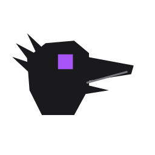

<div align="center">



# Ravendrel — Quantum Programming Language

[](https://github.com/LukaKrajina/Ravendrel/stargazers)
[](https://github.com/LukaKrajina/Ravendrel/network/members)


[中文](./README.md)

</div>

Ravendrel (`.rvdl`) is an experimental quantum programming language targeting quantum computing, neural interfaces, quantum language models, and quantum robotics. This repository ships a VS Code extension, an LLVM JIT runtime, a CLI toolchain, a web inference UI, a desktop editor, and subsystems including VedaROS, QbNS, qchain, and rvdlRSP.

> Still experimental — it will be formalized once general-purpose quantum devices mature.

---

## ✨ What You Can Do

| Area | In one line |
| --- | --- |
| Quantum programming | Allocate / measure qubits, multi-qubit `QObject`, built-in gates, Bell states, state-vector visualization |
| Real quantum hardware | Auto-detect superconducting / trapped-ion / neutral-atom / photonic backends, fall back to QVM simulator offline |
| Quantum machine learning | Variational circuits, parameter-shift gradients, natural gradient, quantum kernels, `QRC` reservoirs, `.rvdlm` export |
| Quantum Language Models | Text → quantum state → training → export → inference, with an OpenAI-compatible HTTP service |
| TQNF | Topological quantum neural fields described by `@layer(time, thread, coord)`; `dla_dim` trainability diagnostics |
| BCI / quantum robotics | QbNS brain network, VedaROS robotics OS, prosthetic / bionic-eye control |
| Systems programming | Bare-metal kernels (QCOS), capability pointers, inline assembly, contract verification, `spawn` concurrency |
| qchain blockchain | Post-quantum crypto (ML-KEM / ML-DSA), QKD, QDBA, unclonable quantum money |
| Language migration | `rvdl migrate` converts OpenQASM / Q# / Quil / Silq sources into `.rvdl` |
| Tooling & ecosystem | VS Code extension, web chat UI, SE editor, rvdlRSP simulator, Android APK builds |

A Bell-state example:

```rvdl
@layer(time=0, thread=0, coord=(0))
int32 rvdl_main() {
    Qubit q0 = alloc();
    Qubit q1 = alloc();
    h(q0);
    cx(q0, q1);       // entangle
    int32 c0 = measure(q0);
    int32 c1 = measure(q1);
    return c0 + c1;
}
```

---

## 📁 Repository Layout

```text
Ravendrel/
├── client/ / server/   VS Code extension client & language server (lexer / parser / IR / CLI / API)
├── runtime/            C++20 runtime: LLVM JIT, QHAL, QLM, QML, VedaROS, QbNS, QCOS
├── RSP/                Quantum robotics simulator (physics / rendering / blueprints / RL / Qt GUI)
├── SE/                 Lightweight desktop editor (Electron + CodeMirror)
├── chatWebUI/          Web inference chat UI (Vite + Tailwind)
├── installer/          Go installer ravendrelup
├── scripts/            All scripts (see scripts/README.md)
│   ├── build/          Build: windows/, linux/, android/, qcos/, check/, wdac/
│   ├── package/        Packaging: vsix/, release/
│   ├── install/        Install & PATH registration
│   ├── generate/       Code / data generators
│   └── sign/ / certs/  Code signing
├── docs/               Reference manuals (start learning here)
├── examples/           Example `.rvdl` programs
├── icons/                 Icons (language/, branding/, products/)
├── syntaxes/ / vendor/    Syntax highlighting, third-party libs
└── LICENSE / NOTICE / THIRD_PARTY_NOTICES.md   Apache-2.0 and third-party credits
```

---

## 🚀 Quick Start

### 1. VS Code Extension (recommended entry point)

```bash
npm install
npm run compile
```

Press `F5` to launch the extension. Open any `.rvdl` file for syntax highlighting, completion, and diagnostics; press `Ctrl+Alt+N` (`Cmd+Alt+N` on macOS) to run.

Package an installable VSIX:

```bash
npm run package:linux   # Linux vsix (bundled runtime)
npm run package:win     # Windows vsix
npm run package:all     # both
```

### 2. Command-Line Tool

After building the runtime (`server/rvdl.cmd` maps to `server/out/cli.js`):

```bash
rvdl run <script.rvdl>                              # execute
rvdl ir <script.rvdl>                               # emit LLVM IR
rvdl compile x64 -e <script.rvdl> [-o out]          # AOT compile to native binary
rvdl verify <script.rvdl>                           # static contract verification
rvdl migrate circuit.qasm --from openqasm2          # migrate quantum-language source
rvdl serve model.rvdlm --port 9080                  # OpenAI-compatible inference service
rvdl build apk <script.rvdl>                        # build an Android APK
```

### 3. Other Components

| Component | How to start |
| --- | --- |
| Real-time quantum visualizer | Terminal 1 `./runtime --daemon`; Terminal 2 `./qvm_visualizer` |
| Web inference UI | `cd chatWebUI && npm install && npm run dev` (start `rvdl serve` first) |
| SE desktop editor | `cd SE && npm install && npm start` (start the daemon first) |
| rvdlRSP simulator | See the [simulation platform manual](docs/rsp-manual.md) |
| Bootable QCOS kernel | See [language manual · systems programming](docs/rvdl-language-manual.md#系统级编程) |

---

## ⚠️ Before You Build

Some config files contain the author's **absolute local paths** (Kokkos / LLVM / CUDA / Qt / compiler locations). Adjust them for your environment, or override via `-D` flags:

| File | What to change |
| --- | --- |
| `runtime/CMakeLists.txt` | `Kokkos_DIR`, GLFW library directory |
| `RSP/CMakeLists.txt` | `Qt6_DIR` (only for `rvdlRSP_gui`) |
| `runtime/.clangd` | Kokkos / CUDA include paths |
| `.vscode/c_cpp_properties.json` / `.vscode/settings.json` | compiler, include paths, workspace path |

---

## 🛠️ Build From Source

### Dependencies

| Dependency | Purpose | Required |
| --- | --- | --- |
| LLVM | JIT / AOT | ✅ |
| Kokkos | Numerics / tensor backend | ✅ |
| Node.js + TypeScript | VS Code extension / language server | ✅ |
| CUDA Toolkit | Kokkos GPU backend | Optional |
| Vulkan SDK + GLFW | Visualizer | Optional |
| Qt 6 | rvdlRSP GUI | Optional |
| Android SDK / NDK + Gradle | APK builds | Optional |
| Go | Installer | Optional |

Install LLVM via vcpkg, MSYS2, or [official prebuilt binaries](https://github.com/llvm/llvm-project/releases); build Kokkos from source into a directory of your choice. See [CONTRIBUTING.md](CONTRIBUTING.md) for details.

### Build the Runtime

```bash
cd runtime
cmake -B build -S . -G Ninja \
  -DCMAKE_CXX_COMPILER="<your C++ compiler>" \
  -DLLVM_DIR="<your LLVM cmake dir>" \
  -DKokkos_DIR="<your Kokkos install>/lib/cmake/Kokkos"
cmake --build build --config Release --parallel
```

Main targets: `rvdl_rt` (quantum core shared library), `runtime` (daemon / stdin), `train_cli` (QLM training), `qvm_visualizer`, `transmitter`, `rvdlRSP`.

### Other Build Entry Points

```bash
# Linux / Windows build scripts
bash scripts/build/linux/build-linux.sh
scripts\build\windows\build.bat

# VSIX packaging is orchestrated by scripts/package/vsix/
# Install to user directory
bash scripts/install/install-system.sh --status
```

More script details: [scripts/README.md](scripts/README.md).

---

## 📚 Learn Ravendrel

All language and subsystem manuals live in `docs/`, written as reference manuals (purpose → syntax/API → examples):

| Manual | Covers |
| --- | --- |
| [rvdl Language Manual](docs/rvdl-language-manual.md) | Syntax cheat sheet, types, control flow, quantum gates, built-ins, diagnostics |
| [Migration Manual](docs/rvdl-migration-manual.md) | OpenQASM / Q# / Quil / Silq → rvdl |
| [Quantum Learning Manual](docs/rvdl-quantum-learning-manual.md) | Full training → export → inference flow and `train_cli` options |
| [TQNF Topological Quantum Learning](docs/rvdl-topological-quantum-learning.md) | `@layer` three-dimensional tags and topological training |
| [Shuttle and Tracking](docs/rvdl-shuttle-tracking.md) | The `shuttle` / `track` keys on `@layer` |
| [BAT Batched Adjoint Training](docs/quantum-batching-theory.md) | minibatch / tile acceleration options |
| [qchain Quantum Blockchain](docs/rvdl-qchain-manual.md) | Post-quantum crypto, QKD, quantum money |
| [rvdlRSP Simulation Platform](docs/rsp-manual.md) | Physics, rendering, quantum RL, prosthetics, Qt GUI |
| [Graphics Acceleration & Model Interop](docs/gfx-acceleration.md) | Pa, safetensors / GGUF, Fox fallback |

Example programs: [examples/](examples/). Changelog: [CHANGELOG.md](CHANGELOG.md).

---

## 🤝 Contributing

Issues and pull requests are welcome. Please read the [contributing guide](CONTRIBUTING.md), [code of conduct](CODE_OF_CONDUCT.md), and [security policy](SECURITY.md) first.

---

## 📄 License

Maintained by **OpenMasons** and released under the [Apache License 2.0](LICENSE) (includes an explicit patent grant). Third-party credits: [THIRD_PARTY_NOTICES.md](THIRD_PARTY_NOTICES.md).

> Code-signing private keys and local WDAC deployment artifacts are not committed; see [SECURITY.md](SECURITY.md).