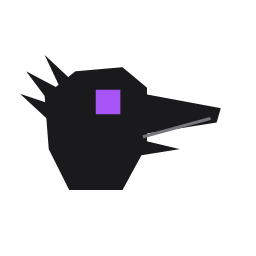

<div align="center">



# Ravendrel — 量子编程语言

[](https://github.com/LukaKrajina/Ravendrel/stargazers)
[](https://github.com/LukaKrajina/Ravendrel/network/members)


[English](./README.en.md)

</div>

Ravendrel（`.rvdl`）是一门实验性量子编程语言，面向量子计算、神经接口、量子语言模型与量子机器人。本仓库提供 VS Code 扩展、LLVM JIT 运行时、命令行工具、Web 推理界面、桌面编辑器，以及 VedaROS / QbNS / qchain / rvdlRSP 等子系统。

> 目前处于实验阶段，等待通用量子设备成熟后才会正式化。

---

## ✨ 能做什么

| 领域 | 一句话说明 |
| --- | --- |
| 量子编程 | 分配 / 测量 Qubit、QObject 多比特对象、内置量子门与 Bell 态、态矢量可视化 |
| 真实量子硬件 | 自动探测超导 / 离子阱 / 中性原子 / 光子后端，离线回退 QVM 模拟器 |
| 量子机器学习 | 变分电路训练、参数移位求导、自然梯度、量子核、`QRC` 储备池，模型导出 `.rvdlm` |
| 量子语言模型 QLM | 文本 → 量子态 → 训练 → 导出 → 加载推理，提供 OpenAI 兼容的 HTTP 服务 |
| TQNF 拓扑量子神经场 | 用 `@layer(time, thread, coord)` 描述拓扑，`dla_dim` 诊断可训练性 |
| 脑机接口 / 量子机器人 | QbNS 脑量子网络、VedaROS 量子机器人 OS、义肢 / 义眼控制 |
| 系统级编程 | 裸机内核（QCOS）、能力指针、内联汇编、契约验证、并发 `spawn` |
| 量子区块链 qchain | 后量子密码（ML-KEM / ML-DSA）、QKD、QDBA、不可克隆量子货币 |
| 语言迁移 | `rvdl migrate` 把 OpenQASM / Q# / Quil / Silq 源码转成 `.rvdl` |
| 工具与生态 | VS Code 扩展、Web 聊天界面、SE 编辑器、rvdlRSP 机器人仿真平台、Android APK 构建 |

一个 Bell 态示例：

```rvdl
@layer(time=0, thread=0, coord=(0))
int32 rvdl_main() {
    Qubit q0 = alloc();
    Qubit q1 = alloc();
    h(q0);
    cx(q0, q1);       // 建立纠缠
    int32 c0 = measure(q0);
    int32 c1 = measure(q1);
    return c0 + c1;
}
```

---

## 📁 仓库结构

```text
Ravendrel/
├── client/ / server/   VS Code 扩展客户端与语言服务器（lexer / parser / IR / CLI / API）
├── runtime/            C++20 运行时：LLVM JIT、QHAL、QLM、QML、VedaROS、QbNS、QCOS
├── RSP/                量子机器人仿真平台（物理 / 渲染 / 蓝图 / RL / Qt GUI）
├── SE/                 轻量桌面编辑器（Electron + CodeMirror）
├── chatWebUI/          Web 推理聊天界面（Vite + Tailwind）
├── installer/          Go 安装器 ravendrelup
├── scripts/            全部脚本（见 scripts/README.md）
│   ├── build/          构建：windows/、linux/、android/、qcos/、check/、wdac/
│   ├── package/        打包：vsix/、release/
│   ├── install/        安装与 PATH 注册
│   ├── generate/       代码 / 数据生成
│   └── sign/ / certs/  代码签名
├── docs/               参考手册（学习入口）
├── examples/           示例 `.rvdl` 程序
├── icons/                 图标（language/ 语言图标、branding/ 展示图、products/ 子产品）
├── syntaxes/ / vendor/    语法高亮、第三方库
└── LICENSE / NOTICE / THIRD_PARTY_NOTICES.md   Apache-2.0 与第三方声明
```

---

## 🚀 快速开始

### 1. VS Code 扩展（推荐入门）

```bash
npm install
npm run compile
```

按 `F5` 启动扩展调试。打开任意 `.rvdl` 文件即可获得语法高亮、补全与语义诊断；`Ctrl+Alt+N`（macOS `Cmd+Alt+N`）运行脚本。

打包安装：

```bash
npm run package:linux   # Linux vsix（自带 runtime）
npm run package:win     # Windows vsix
npm run package:all     # 两个平台
```

### 2. 命令行工具

构建运行时后（`server/rvdl.cmd` 映射 `server/out/cli.js`）：

```bash
rvdl run <script.rvdl>                              # 运行
rvdl ir <script.rvdl>                               # 只看 LLVM IR
rvdl compile x64 -e <script.rvdl> [-o out]          # AOT 编译为原生二进制
rvdl verify <script.rvdl>                           # 静态契约验证
rvdl migrate circuit.qasm --from openqasm2          # 迁移量子语言源码
rvdl serve model.rvdlm --port 9080                  # 启动 OpenAI 兼容推理服务
rvdl build apk <script.rvdl>                        # 构建 Android APK
```

### 3. 其他组件

| 组件 | 启动方式 |
| --- | --- |
| 实时量子可视化器 | 终端 1 `./runtime --daemon`；终端 2 `./qvm_visualizer` |
| Web 推理界面 | `cd chatWebUI && npm install && npm run dev`（需先启动 `rvdl serve`） |
| SE 桌面编辑器 | `cd SE && npm install && npm start`（需先启动 daemon） |
| rvdlRSP 仿真平台 | 见 [仿真平台手册](docs/rsp-manual.md) |
| 可启动内核 QCOS | 见 [语言手册 · 系统级编程](docs/rvdl-language-manual.md#系统级编程) |

---

## ⚠️ 构建前必读

仓库中部分配置文件含作者本机的**绝对路径**（Kokkos / LLVM / CUDA / Qt / 编译器位置）。构建前需按你的实际安装位置修改，或通过命令行 `-D` 参数覆盖：

| 文件 | 需修改项 |
| --- | --- |
| `runtime/CMakeLists.txt` | `Kokkos_DIR`、GLFW 库目录 |
| `RSP/CMakeLists.txt` | `Qt6_DIR`（仅构建 `rvdlRSP_gui` 时需要） |
| `runtime/.clangd` | Kokkos / CUDA 的 include 路径 |
| `.vscode/c_cpp_properties.json` / `.vscode/settings.json` | 编译器路径、include 路径、工作区路径 |

---

## 🛠️ 从源码构建

### 依赖

| 依赖 | 用途 | 必需 |
| --- | --- | --- |
| LLVM | JIT / AOT | ✅ |
| Kokkos | 数值 / 张量后端 | ✅ |
| Node.js + TypeScript | VS Code 扩展 / 语言服务器 | ✅ |
| CUDA Toolkit | Kokkos 的 GPU 后端 | 可选 |
| Vulkan SDK + GLFW | 可视化器 | 可选 |
| Qt 6 | rvdlRSP GUI | 可选 |
| Android SDK / NDK + Gradle | APK 构建 | 可选 |
| Go | 安装器 | 可选 |

LLVM 可用 vcpkg / MSYS2 / [官方预编译包](https://github.com/llvm/llvm-project/releases)任一方式安装；Kokkos 从源码编译并安装到自定义目录。详见下方依赖小节与 [CONTRIBUTING.md](CONTRIBUTING.md)。

### 编译运行时

```bash
cd runtime
cmake -B build -S . -G Ninja \
  -DCMAKE_CXX_COMPILER="<你的 C++ 编译器>" \
  -DLLVM_DIR="<你的 LLVM cmake 目录>" \
  -DKokkos_DIR="<你的 Kokkos 安装>/lib/cmake/Kokkos"
cmake --build build --config Release --parallel
```

主要产物：`rvdl_rt`（量子核心共享库）、`runtime`（守护进程 / stdin 交互）、`train_cli`（QLM 训练）、`qvm_visualizer`、`transmitter`、`rvdlRSP`。

### 其他构建入口

```bash
# Linux / Windows 构建脚本
bash scripts/build/linux/build-linux.sh
scripts\build\windows\build.bat

# VSIX 打包流程由 scripts/package/vsix/ 编排
# 安装到用户目录
bash scripts/install/install-system.sh --status
```

更多脚本说明见 [scripts/README.md](scripts/README.md)。

---

## 📚 学习 Ravendrel

所有语言与子系统手册都在 `docs/`，按参考手册风格编写（用途 → 语法/API → 示例）：

| 手册 | 内容 |
| --- | --- |
| [rvdl 语言手册](docs/rvdl-language-manual.md) | 语法速查、类型、控制流、量子门、内置函数、诊断码 |
| [迁移手册](docs/rvdl-migration-manual.md) | OpenQASM / Q# / Quil / Silq → rvdl |
| [量子学习手册](docs/rvdl-quantum-learning-manual.md) | 训练、导出、推理的完整流程与 `train_cli` 参数 |
| [TQNF 拓扑量子神经场](docs/rvdl-topological-quantum-learning.md) | `@layer` 三维标签与拓扑训练 |
| [穿梭与追踪](docs/rvdl-shuttle-tracking.md) | `@layer` 的 `shuttle` / `track` 键 |
| [BAT 批量伴随训练](docs/quantum-batching-theory.md) | minibatch / tile 加速参数 |
| [qchain 量子区块链](docs/rvdl-qchain-manual.md) | 后量子密码、QKD、量子货币 |
| [rvdlRSP 仿真平台](docs/rsp-manual.md) | 物理、渲染、量子 RL、义肢义眼、Qt GUI |
| [图形加速与模型互转](docs/gfx-acceleration.md) | Pa、safetensors / GGUF、Fox 回退 |

示例程序在 [examples/](examples/)，变更记录在 [CHANGELOG.md](CHANGELOG.md)。

---

## 🤝 参与贡献

欢迎提交 Issue 与 Pull Request。请先阅读 [贡献指南](CONTRIBUTING.md)、[行为准则](CODE_OF_CONDUCT.md) 与 [安全策略](SECURITY.md)。

---

## 📄 许可证

本项目由 **OpenMasons** 维护，以 [Apache License 2.0](LICENSE) 开源（含明确专利授权）。第三方组件声明见 [THIRD_PARTY_NOTICES.md](THIRD_PARTY_NOTICES.md)。

> 代码签名私钥与本机 WDAC 部署产物不入库；详见 [SECURITY.md](SECURITY.md)。